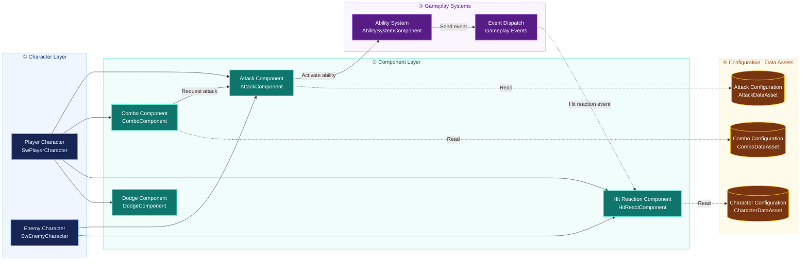

## What Is Component-Based Design?

Component-based design assigns a capability with clear state, behavior, and a lifecycle to a component that can be attached to a host Actor.

Consider doors: ordinary doors, locked doors, timed doors, destructible doors, and timed destructible doors that require a key. Creating a subclass for every combination can quickly cause a subclass explosion. Components offer another approach:

- `ADoor` represents the door in the world and its mesh/animation.
- `ULockComponent` manages lock checks and lock state.
- `UHealthComponent` manages damage and death.

## How Components Work: A Source Code Perspective

### 1. Default Components and Runtime Components

UObject::CreateDefaultSubobject is the entry point for declaring default subobjects inside a constructor.

```cpp
Lock = CreateDefaultSubobject<ULockComponent>(TEXT("Lock"));
```

Adding a component dynamically at runtime is different: NewObject first creates the UObject, after which you must also consider the Actor's instance component records, registration, removal, and networking. A common sequence is:

```cpp
// Owner 是已经存在于 World 的 Actor。
ULockComponent* Lock = NewObject<ULockComponent>(Owner);
Owner->AddInstanceComponent(Lock);
Lock->RegisterComponent();
// 不再需要时由拥有者调用 Lock->DestroyComponent()，并清理外部订阅。
```

`AActor::AddInstanceComponent` sets `CreationMethod::Instance` and adds the component to `InstanceComponents`. Registration first checks whether the Owner's `UWorld` is valid, then calls `RegisterComponentWithWorld`, which checks object validity, whether it is already registered, and whether a World exists.

### 2. The Actual Conditions for BeginPlay

AActor::BeginPlay iterates over components and calls BeginPlay only on those for which IsRegistered() is true and HasBegunPlay() is false:

```cpp
for (UActorComponent* Component : Components)
{
    // bHasBegunPlay will be true for the component if the component was renamed and moved to a new outer during initialization
    if (Component->IsRegistered() && !Component->HasBegunPlay())
    {
        Component->RegisterAllComponentTickFunctions(true);
        Component->BeginPlay();
        ensureMsgf(Component->HasBegunPlay(), TEXT("Failed to route BeginPlay (%s)"), *Component->GetFullName());
    }
}
```

If the Actor has already begun play, a subsequently registered component follows the initialization and BeginPlay path through UActorComponent::RegisterComponentWithWorld → AActor::HandleRegisterComponentWithWorld.

```cpp
void AActor::HandleRegisterComponentWithWorld(UActorComponent* Component)
{
	const bool bOwnerBeginPlayStarted = HasActorBegunPlay() || IsActorBeginningPlay();

	if (!Component->HasBeenInitialized() && Component->bWantsInitializeComponent && IsActorInitialized())
	{
		Component->InitializeComponent();

		// The component was finally initialized, it can now be replicated
		// Note that if this component does not ask to be initialized, it would have started to be replicated inside AddOwnedComponent.
		if (bOwnerBeginPlayStarted && Component->GetIsReplicated())
		{
			AddComponentForReplication(Component);
		}
	}

	if (bOwnerBeginPlayStarted)
	{
		Component->RegisterAllComponentTickFunctions(true);

		if (!Component->HasBegunPlay())
		{
			Component->BeginPlay();
			ensureMsgf(Component->HasBegunPlay(), TEXT("Failed to route BeginPlay (%s)"), *Component->GetFullName());
		}
	}
}
```

### 3. Lifecycle

An Actor maintains its owned components. In BeginDestroy, it calls UnregisterAllComponents. That method iterates over the Actor's components and calls UnregisterComponent on each one, which unregisters events and Tick functions.

```cpp
void UActorComponent::UnregisterComponent()
{
	SCOPE_CYCLE_COUNTER(STAT_UnregisterComponent);
	FScopeCycleCounterUObject ComponentScope(this);

	// Do nothing if not registered
	if(!IsRegistered())
	{
		UE_LOG(LogActorComponent, Log, TEXT("UnregisterComponent: (%s) Not registered. Aborting."), *GetPathName());
		return;
	}

	// If registered, should have a world
	checkf(WorldPrivate != nullptr, TEXT("%s"), *GetFullName());

	RegisterAllComponentTickFunctions(false);
	ExecuteUnregisterEvents();

	WorldPrivate = nullptr;
}
```

DestroyComponent is the semantic entry point for ending a component's lifetime. External subscribers should still unbind its delegates according to the application's rules. Garbage collection and component unregistration do not choose the UI's next data source for it.

## Data-Driven Design: DataAssets and Class Defaults

UDataAsset stores data for a system, and assets based on native subclasses can be created in the Content Browser. Consider UPrimaryDataAsset when you need an AssetManager primary asset ID, asset bundles, or explicit loading/unloading management.

> The distinction is:
>
> - `UDataAsset` stores configuration data.
> - `UPrimaryDataAsset` additionally provides a default implementation for integration with the `UAssetManager` primary asset management system.
>
> **1. Primary Asset ID**
>
> `UPrimaryDataAsset` provides an `FPrimaryAssetId` by default, consisting of an asset Type and Name.
>
> For example, AssetManager can use `Equipment:DA_Sword` to locate and load a registered asset without requiring the caller to hold an asset reference or path directly.
>
> **2. Asset Bundles**
>
> Asset Bundles group the resources referenced by a primary asset according to their purpose, enabling loading on demand.
>
> ```cpp
> UPROPERTY(EditDefaultsOnly, meta=(AssetBundles="UI"))
> TSoftObjectPtr<UTexture2D> Icon;
> 
> UPROPERTY(EditDefaultsOnly, meta=(AssetBundles="Game"))
> TSoftObjectPtr<USkeletalMesh> WeaponMesh;
> ```
>
> For example, opening the inventory can load only the icons in the `UI` group, while actually equipping an item loads the model in the `Game` group, avoiding unnecessary resource loading.
>
> **3. Loading and Unloading Management**
>
> AssetManager provides a unified interface for resource lifecycle management:
>
> - `LoadPrimaryAsset()`: load a primary asset and the specified bundles.
> - `ChangeBundleStateForPrimaryAssets()`: change which resource groups are loaded.
> - `UnloadPrimaryAsset()`: release AssetManager's load retention for the primary asset.
>
> Unloading does not mean immediate destruction. Resources may remain in memory while hard references still exist.
>
> **Summary**
>
> - `UDataAsset`: suitable for ordinary static data such as movement parameters and attack configurations.
> - `UPrimaryDataAsset`: suitable for equipment, items, character configurations, and other assets that require lookup by ID, grouped loading, or centralized lifecycle management.

The class default object (CDO) is another configuration source. UClass::GetDefaultObject returns the CDO, and Blueprint subclasses can override default properties.

Blueprint subclass defaults work well when each door type has a stable class and default mesh/component structure. DataAssets are more suitable when the same door logic has many reusable configurations that should be referenced, reviewed, or swapped as independent assets.

```cpp
UCLASS(BlueprintType)
class UDoorDefinition : public UDataAsset
{
    GENERATED_BODY()
public:
    UPROPERTY(EditDefaultsOnly, BlueprintReadOnly)
    float InteractionRange = 200.f;

    UPROPERTY(EditDefaultsOnly, BlueprintReadOnly)
    bool bStartsLocked = false;
};

// ADoor 内：配置引用和每个门自己的运行状态分开。
UPROPERTY(EditDefaultsOnly, Category="Door")
TObjectPtr<UDoorDefinition> Definition;

UPROPERTY(VisibleInstanceOnly, Category="Door")
bool bIsOpen = false;
```

### When Are Components a Poor Fit?

Ask these questions when deciding whether a component is appropriate:

1. Can its public interface be explained through 2–5 stable operations, or must external code repeatedly read and write its internal fields?
2. Can it independently maintain an invariant, such as a health range, inventory capacity, or lock state?
3. Would it still work with a different host? If `Cast<ADoor>(GetOwner())` appears everywhere, the code may simply have been moved from the door into a component.

### An Example with Clear Responsibilities


