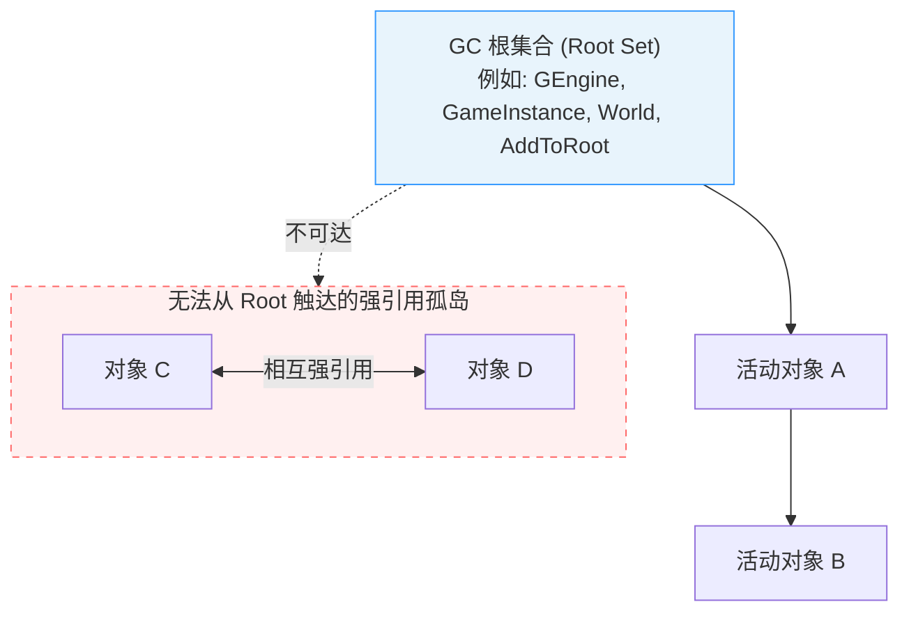
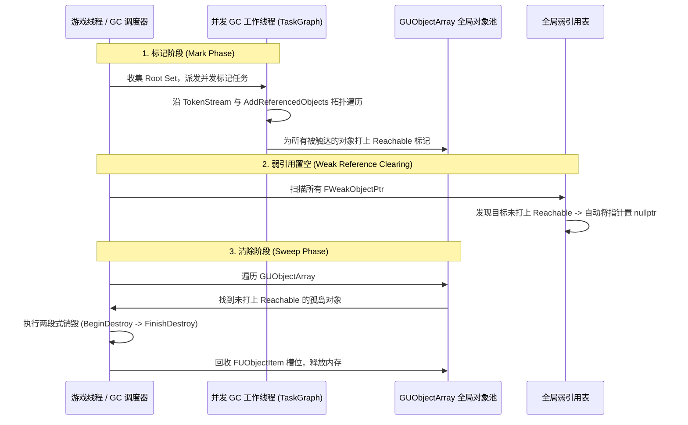

本文仅作为个人在学习过程中的记录，如有错误，欢迎指出！

## 引用计数与追踪式标记-清除

垃圾回收（GC）的核心职责是在对象不再被使用时安全地结束其生命周期并回收其占用的内存，杜绝内存泄漏或悬空野指针。 

### 引用计数

对于现代 C++，更多的是依托 RAII 管理资源。当多个所有者需要共享所有权时，常借助引用计数来管理销毁。

**问题：**

1. 每个对象需要额外维护一份原子计数器。

2. 对于跨线程赋值，会触发原子操作，严重拖慢主循环。

3. 同时还需要处理循环引用，需准确使用弱引用。 

4. 内存释放随时可能发生，容易产生突发卡顿。 

### 追踪式标记-清除

商业级游戏引擎几乎无一例外采用追踪式标记-清除（Tracing Mark-and-Sweep）。

**优势：**

1. 集中在全局对象表中管理。 

2. 运行时对象赋值即作为普通指针写入，无原子开销。 

3. 对于存在循环引用的对象，只要这类对象无法从根节点触达，则会被一并清理。 

4. 集中或增量调度，执行时机确定，利于帧时间预算控制。

> **集中调度**：GC 在一次回收过程中集中完成大量工作，可能导致某一帧耗时突然增加。
> 
> **增量调度**：将 GC 工作拆成多个小步骤，分散到不同帧执行，降低单帧卡顿风险。
>
> **帧时间预算**：规定每帧允许某项工作消耗多少时间。GC 尽量在预算范围内完成部分任务，剩余工作留到后续帧。

### 虚幻引擎 GC 方式选择

虚幻引擎以 **追踪式 Mark-and-Sweep** 为核心构建了整套对象生命周期管理体系。



每一轮 GC 当中，引擎都会从根集合出发，对于不可达的部分，就会当作垃圾进行回收。 

## GC 的数据库

首先需要搞清楚，GC 它是怎么知道有哪些 UObject 的。 

### GUObjectArray

所有 UObject 实例都会在**全局对象表** GUObjectArray 中注册。

```cpp
extern COREUOBJECT_API FUObjectArray GUObjectArray;
```

GUObjectArray 负责对象注册、索引分配与回收等工作。

其中 ObjObjects 负责保存对象。

```cpp
TUObjectArray ObjObjects;
```

### FUObjectItem

FUObjectItem 是数组中的一个槽位，保存对象的指针以及内部状态：

```cpp
struct FUObjectItem
{
	// 指向实际的 UObject
	class UObjectBase* Object;

	// 内部状态标记（EInternalObjectFlags）
	int32 Flags;

	// 所属 GC 簇根节点索引
	int32 ClusterRootIndex;	

	// Weak Object Pointer Serial number associated with the object
	int32 SerialNumber;
};
```

GC 中常用的 Flag：

可达性

```cpp
// Reachable 
EInternalObjectFlags GReachableObjectFlag = EInternalObjectFlags::ReachabilityFlag0;

// Unreachable
EInternalObjectFlags GUnreachableObjectFlag = EInternalObjectFlags::ReachabilityFlag1;

// MaybeUnreachable
EInternalObjectFlags GMaybeUnreachableObjectFlag = EInternalObjectFlags::ReachabilityFlag2;
```

## 根集合

GC 算法不可能凭空猜测从哪里开始扫描，它必须依赖一组必定存活的源头，即 根集合（Root Set）。

哪些属于根集合？

1. 引擎核心全局单例：GEngine、UGameEngine 等顶级系统对象。

2. 游戏主链路核心：活动关卡中的 UWorld、UGameInstance、挂载在世界中的主 Level。

3. 显式根对象：通过 C++ 手动调用了 Object->AddToRoot() 的任何 UObject。注意需要显式调用 RemoveFromRoot()，否则永远不会被 GC 回收。

## 如何接入 GC ？

有了这个根集合之后，还需要知道这个根对象它可以一路触达哪些下游对象。 

### UPROPERTY 宏


### FGCObject

对于原生 C++ 类可以主动进行备份。 

```cpp
#include "UObject/GCObject.h"

class FCustomNativeManager : public FGCObject
{
public:
    UTexture2D* CachedIcon = nullptr;

    // 重写 FGCObject 核心虚函数
    virtual void AddReferencedObjects(FReferenceCollector& Collector) override
    {
        // 主动向 GC 报备：我手头持有着这个 UObject，请把它算作可达！
        Collector.AddReferencedObject(CachedIcon);
    }
};
```

1. FGCObject 在构造函数中会自动将自身指针注册进全局链表 FGCObject::GGCObjectList。
2. 在 GC 的 Mark 阶段，引擎会自动轮询遍历这批原生对象，调用它们的 AddReferencedObjects，从而将原生类中的 UObject* 纳入可达性图谱！

%22%20viewBox%3D%220%200%20340%20285%22%20width%3D%22100%25%22%20xmlns%3D%22http%3A%2F%2Fwww.w3.org%2F2000%2Fsvg%22%3E%3Crect%20x%3D%225%22%20y%3D%225%22%20width%3D%22330%22%20height%3D%22275%22%20rx%3D%2212%22%20fill%3D%22%2364748b%22%20fill-opacity%3D%22.055%22%20stroke%3D%22%2394a3b8%22%20stroke-opacity%3D%22.5%22%2F%3E%3Ctext%20x%3D%22170%22%20y%3D%2227%22%20text-anchor%3D%22middle%22%20font-size%3D%2213%22%20font-weight%3D%22700%22%20fill%3D%22currentColor%22%3EUE%20GC%20%E5%8F%AF%E8%BE%BE%E6%80%A7%E5%88%86%E6%9E%90%3C%2Ftext%3E%3Crect%20x%3D%2220%22%20y%3D%2244%22%20width%3D%22139%22%20height%3D%2262%22%20rx%3D%228%22%20fill%3D%22%232563eb%22%20fill-opacity%3D%22.12%22%20stroke%3D%22%233b82f6%22%2F%3E%3Ctext%20x%3D%2289.5%22%20y%3D%2262%22%20font-size%3D%2212%22%20text-anchor%3D%22middle%22%20fill%3D%22currentColor%22%20font-weight%3D%22700%22%3EGUObjectArray%3C%2Ftext%3E%3Ctext%20x%3D%2289.5%22%20y%3D%2280%22%20font-size%3D%2210%22%20text-anchor%3D%22middle%22%20fill%3D%22currentColor%22%3E%E6%89%80%E6%9C%89%E5%B7%B2%E6%B3%A8%E5%86%8C%20UObject%3C%2Ftext%3E%3Ctext%20x%3D%2289.5%22%20y%3D%2294%22%20font-size%3D%2210%22%20text-anchor%3D%22middle%22%20fill%3D%22currentColor%22%3E%E5%AE%9E%E4%BE%8B%E7%9A%84%E5%AF%B9%E8%B1%A1%E7%B4%A2%E5%BC%95%E8%A1%A8%3C%2Ftext%3E%3Crect%20x%3D%22181%22%20y%3D%2244%22%20width%3D%22139%22%20height%3D%2262%22%20rx%3D%228%22%20fill%3D%22%23d97706%22%20fill-opacity%3D%22.12%22%20stroke%3D%22%23d97706%22%2F%3E%3Ctext%20x%3D%22250.5%22%20y%3D%2262%22%20font-size%3D%2212%22%20text-anchor%3D%22middle%22%20fill%3D%22currentColor%22%20font-weight%3D%22700%22%3EGGCObjectList%3C%2Ftext%3E%3Ctext%20x%3D%22250.5%22%20y%3D%2280%22%20font-size%3D%2210%22%20text-anchor%3D%22middle%22%20fill%3D%22currentColor%22%3EFGCObject%20%E6%B3%A8%E5%86%8C%E5%AF%B9%E8%B1%A1%3C%2Ftext%3E%3Ctext%20x%3D%22250.5%22%20y%3D%2294%22%20font-size%3D%2210%22%20text-anchor%3D%22middle%22%20fill%3D%22currentColor%22%3E%E5%8E%9F%E7%94%9F%20C%2B%2B%20%E5%BC%95%E7%94%A8%E6%8F%90%E4%BE%9B%E8%80%85%3C%2Ftext%3E%3Cpath%20d%3D%22M89%20106%20V136%20H170%20V160%20M251%20106%20V136%20H170%22%20stroke%3D%22%2364748b%22%20stroke-width%3D%221.6%22%20fill%3D%22none%22%2F%3E%3Cpath%20d%3D%22M165%20153%20L170%20160%20L175%20153%22%20stroke%3D%22%2364748b%22%20stroke-width%3D%221.6%22%20fill%3D%22none%22%2F%3E%3Crect%20x%3D%2262%22%20y%3D%22161%22%20width%3D%22216%22%20height%3D%2243%22%20rx%3D%228%22%20fill%3D%22%230d9488%22%20fill-opacity%3D%22.12%22%20stroke%3D%22%230d9488%22%2F%3E%3Ctext%20x%3D%22170%22%20y%3D%22178%22%20font-size%3D%2212%22%20font-weight%3D%22700%22%20text-anchor%3D%22middle%22%20fill%3D%22currentColor%22%3EGC%20%E5%BC%95%E7%94%A8%E6%94%B6%E9%9B%86%E4%B8%8E%E5%8F%AF%E8%BE%BE%E6%80%A7%E5%88%86%E6%9E%90%3C%2Ftext%3E%3Ctext%20x%3D%22170%22%20y%3D%22193%22%20font-size%3D%2210%22%20text-anchor%3D%22middle%22%20fill%3D%22currentColor%22%3E%E8%AF%86%E5%88%AB%E4%BB%8D%E7%84%B6%E5%8F%AF%E8%BE%BE%E7%9A%84%20UObject%3C%2Ftext%3E%3Cpath%20d%3D%22M170%20204%20V224%22%20stroke%3D%22%2364748b%22%20stroke-width%3D%221.6%22%2F%3E%3Cpath%20d%3D%22M165%20218%20L170%20225%20L175%20218%22%20stroke%3D%22%2364748b%22%20stroke-width%3D%221.6%22%20fill%3D%22none%22%2F%3E%3Crect%20x%3D%2277%22%20y%3D%22226%22%20width%3D%22186%22%20height%3D%2238%22%20rx%3D%228%22%20fill%3D%22%2364748b%22%20fill-opacity%3D%22.1%22%20stroke%3D%22%2394a3b8%22%2F%3E%3Ctext%20x%3D%22170%22%20y%3D%22242%22%20font-size%3D%2211%22%20text-anchor%3D%22middle%22%20fill%3D%22currentColor%22%3E%E4%BF%9D%E7%95%99%E5%8F%AF%E8%BE%BE%20UObject%3C%2Ftext%3E%3Ctext%20x%3D%22170%22%20y%3D%22256%22%20font-size%3D%2211%22%20text-anchor%3D%22middle%22%20fill%3D%22currentColor%22%3E%E5%9B%9E%E6%94%B6%E4%B8%8D%E5%8F%AF%E8%BE%BE%20UObject%3C%2Ftext%3E%3C%2Fsvg%3E)

注意区分前面提到的**全局对象表**。

## 标记-清除（Mark & Sweep）全流程

